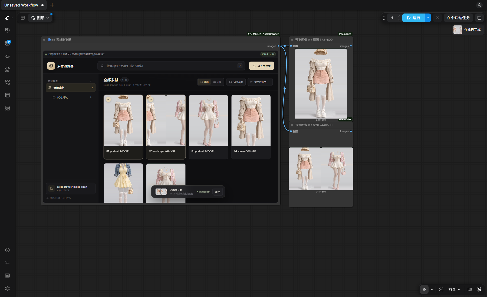

# 🔵BB MIBOX

一个 ComfyUI 自定义节点包，包含两个节点：

- **🔵BB MIBOX 3D视口**（`MIBOXViewer`）：内嵌 MIBOX HTML 3D 视口，接收 `Create 3D Animation File` 的 `model_3d` 输出，累积导入模型，并把红色线框内的视口内容作为 `IMAGE` 输出。
- **🔵BB 素材浏览器**（`MIBOXAssetBrowser`）：内嵌本地图片素材浏览器，按文件夹分类浏览、多选图片，从一个 `IMAGE` 输出口输出为 batch。

## 安装

把整个 `MIBOX_Viewer` 文件夹放到：

```
ComfyUI/custom_nodes/MIBOX_Viewer
```

然后完全关闭并重启 ComfyUI，浏览器端按 `Ctrl + F5` 强制刷新一次。

无需额外 pip 依赖，使用 ComfyUI 自带的 `torch`、`numpy`、`Pillow`。

## 3D视口

在节点菜单搜索 `MIBOX 3D视口`，分类为 `🔵BB 3DViewer`。

- 输入 `model_3d`：连接到 `Create 3D Animation File`（`BuildPoseFile`）的 `model_3d` 输出。
- 默认每次执行都会把新的 `model_3d` **追加**到内嵌视口；关闭右上角 `累积` 后会停止接收新模型，保留当前视口内容（是否导入以本次执行的 `accumulate_input` 为准，不受页面刷新影响）。
- `frame_width` / `frame_height`：红色输出线框的宽高；输出图像按该线框区域裁剪，尺寸与线框一致（截图和序列帧会向下取到偶数，例如 725→724，避免 H.264/AV1 拒绝奇数尺寸）。
- `hide_frame`：隐藏红色线框；隐藏后输出仍按该线框区域裁剪。
- 输出 `image`：红色线框内的 PNG 截图，可直接连接到 `PreviewImage` / `SaveImage` 等节点。
- 输出 `sequence`：动画序列帧，`IMAGE` batch（batch size = 帧数）。
- `sequence_fps`：序列帧采样帧率（默认 24，1–60）。
- 视口右上角有 `累积: 开` / `输入: 停` 按钮：开启时接收并追加模型；关闭后停止接收新的 `model_3d`，只输出当前视口。
- 视口右上角有 `清空模型` 按钮，用于清空当前累积的模型。
- 内嵌视口工具栏右侧有背景颜色按钮和背景图片按钮。
- 导入背景图片后，默认按图片比例完整显示（约 80% 视口大小），不会拉伸铺满节点；滚轮可以继续放大/缩小。
- 点击工具栏的 `调整` 按钮进入背景调整模式：拖动平移，滚轮缩放；再次点击退出调整模式。
- 选择纯色背景会移除当前背景图片。

### 动画与序列帧

- 带动画的模型不会自动循环播放，加载后停在第一帧。
- 视口右上角有 `播放动画` 按钮（没有动画时显示 `无动画` 并禁用）：点击后按 `sequence_fps` 播放**一遍**，不循环，播放完停在最后一帧。
- 把 `sequence` 输出连接到下游节点（如 `SaveImage`、视频合成节点）后运行队列：节点会先导入模型，再播放一遍动画并按 `sequence_fps` 采集序列帧，`sequence` 输出为 batch。
- 没有连接 `sequence` 输出时不会采集序列帧，运行不会多花时间，`sequence` 输出回退为单帧截图。
- 序列帧数 = 动画时长 × `sequence_fps`，最多 600 帧；超过时会在界面提示降低帧率，本次回退为单帧。
- `播放动画` 按钮只做预览，不会写入序列帧；序列帧在运行队列时产生。
- 如果模型已经导入视口、只想再采集一次，可以先关闭 `累积`（显示 `输入: 停`）再运行，避免同一个模型被重复导入。
- 保存视频：`sequence` 可以接核心的 `Create Video` → `Save Video`，或 VideoHelperSuite 的「合并为视频」。`Create Video` 只负责把图片 batch 转成视频对象，本身不保存文件。

### 3D视口说明

- 节点本身不再显示额外的输出预览区域，只保留 HTML 视口和红色线框。
- 节点执行时会通过 WebSocket 通知浏览器内嵌视口导入模型，等浏览器回传截图后再继续执行，因此需要保持 ComfyUI 页面打开。
- 如果通过纯 API 方式运行、没有打开 ComfyUI 页面，节点会在等待超时后输出上一张截图或黑色占位图。
- 内嵌视口支持 GLB/GLTF/FBX/OBJ；GLB/GLTF/FBX 自带的第一个动画停在第一帧，等待播放。
- HTML 内 Three.js 从 unpkg CDN 加载，首次打开需要能访问外网。
- 播放按钮要等模型已经导入视口后才能用：先运行一次让节点导入模型，再点击 `播放动画`。

## 素材浏览器



不需要额外点击「应用到节点」：选择图片后会自动同步。可以直接使用 ComfyUI 自带的 **预览图像 / Preview Image** 节点；多个预览图像节点连接到同一个输出口时，会自动分别显示不同图片，并保持每张原图的尺寸和宽高比。

1. 在节点菜单搜索「素材浏览器」或 `MIBOX`，添加 **🔵BB 素材浏览器**，分类为 `🔵BB 3DViewer`。
2. 点击内嵌页面里的「导入文件夹」，或把文件夹拖进去。
3. 子文件夹会自动成为分类树；点击图片选择，`Ctrl / ⌘` 多选，`Shift` 连选。
4. 选好后会自动同步。节点状态栏显示「已自动同步 N 张」即可。
5. 把素材浏览器的唯一输出口 `images` 连接到 **ComfyUI 自带的预览图像** 节点（或任何图像处理节点），直接运行。

示例工作流可直接拖入 ComfyUI：`example_workflow.json`，里面是一个素材浏览器 + 两个标准「预览图像」节点，连接好后直接运行即可。

### 多个标准预览节点显示不同图片

1. 添加 **两个或更多** ComfyUI 自带的「预览图像」节点。
2. 把它们都连接到素材浏览器同一个 `images` 输出口。
3. 直接运行队列。每个预览图像节点会按节点创建顺序（节点 ID 顺序）自动取不同的一帧：第 1 个预览取第 1 张，第 2 个取第 2 张；预览节点数量超过图片数量时从第 1 张开始循环。
4. 如果只连接 **一个** 标准预览节点，ComfyUI 保持默认行为，会在该节点中显示整个 batch。

> ComfyUI 的一条连线传递的是同一份 batch。插件只针对「输入来自 MIBOX 素材浏览器，并且同一输出口连接了多个标准 PreviewImage」这种情况，对标准预览节点的取帧逻辑做了一个很窄的扩展。每个预览节点会直接读取自己对应的原始上传文件，因此预览图保留原始尺寸和宽高比。其他来源的 PreviewImage，以及只连接一个预览节点的情况，都保持 ComfyUI 原本行为。

### 自动同步

- 选择图片后会自动把图片写入 `ComfyUI/input/mibox_asset_browser/<会话>/`，并更新节点数据。
- 如果选完图片立刻点「运行」，插件会让队列等自动同步完成后再提交，避免预览拿到旧图。
- 状态：`未同步` / `正在自动同步…` / `已自动同步 N 张` / `失败`。

### 输出与尺寸

- 输出始终只有一个 `IMAGE` 口，选中 N 张就是 batch size = N。
- 多个标准预览节点会直接显示各自的原图文件，因此预览图可以保留不同的原始尺寸和宽高比（例如 372×500 和 744×500）。
- 唯一 `IMAGE` 输出本身仍必须是规整的 tensor batch，所以发给下游节点的 batch 会保持原比例、居中填充到最大宽高（黑色填充）。
- 图片按素材浏览器里的文件路径顺序输出，不按点击顺序。
- 单次最多同步 **300 张**图片。批次很大时注意显存/内存。

### 工作流持久化

- 同步后的图片路径保存在隐藏的 `images_data` widget 中，随工作流一起保存。
- 图片文件保存在 `ComfyUI/input/mibox_asset_browser/<会话>/`。重新打开工作流或重启 ComfyUI 后，只要文件还在，节点仍可执行。
- 更换电脑或分享工作流时不会自动携带 input 文件；需要在目标机器重新选择图片。
- 每次上传时会清理超过 30 天的旧会话目录。
- 页面刷新或重启后，内嵌浏览器不会保留上次的素材选择；节点里已经同步好的结果会保留。

## 文件结构

```
nodes.py                 3D视口节点、模型临时文件、截图路由
asset_browser.py         素材浏览器节点、上传路由、图片 batch、PreviewImage 窄范围扩展
__init__.py              注册 NODE_CLASS_MAPPINGS、WEB_DIRECTORY
web/js/mibox_viewer.js   3D视口 addDOMWidget + iframe + 截图回传
web/js/asset_browser.js  素材浏览器 addDOMWidget + iframe + 自动同步 + 队列等待
web/MIBOX-V1.2.html      3D视口 HTML
web/asset_browser.html   素材浏览器 HTML（?embed=1 时自动同步到节点）
example_workflow.json    素材浏览器示例工作流
docs/usage.png           素材浏览器使用效果图
```

两个节点都用 `addDOMWidget()` 把 HTML 以 iframe 嵌入，前端文件通过 `WEB_DIRECTORY = "./web"` 暴露到 `/extensions/MIBOX_Viewer/`。

## 常见问题

**节点里没有出现内嵌页面，只有一条状态栏？**

检查浏览器控制台是否加载失败：

```
/extensions/MIBOX_Viewer/MIBOX-V1.2.html
/extensions/MIBOX_Viewer/asset_browser.html
/extensions/MIBOX_Viewer/js/asset_browser.js
```

重启 ComfyUI 后按 `Ctrl + F5` 清理前端缓存。

**两个预览图像节点显示的还是同一整批图片**

- 确认两个节点都是 ComfyUI 自带的「预览图像 / Preview Image」。
- 确认两个节点的 `IMAGE` 输入都直接连接到素材浏览器的同一个 `images` 输出口。
- 确认预览节点数量至少为 2；只连 1 个时 ComfyUI 默认展示整批。
- 自动分图按节点 ID，不按画布位置；如果节点被绕过/禁用，可能导致实际参与运行的预览数量变化。

**点击运行后没有立即开始**

队列正在等待自动同步完成（通常只有短暂时间）。状态栏显示「已自动同步 N 张」后就会提交。

**自动同步失败**

- 图片必须是 Pillow 能读取的栅格图片，例如 JPG、PNG、WEBP、BMP、GIF。SVG、部分 HEIC 图片无法用于节点输出。
- 单次最多 300 张。
- 查看 ComfyUI 控制台是否有 `[MIBOX AssetBrowser] upload error`。

**运行时报“请先在节点内选择图片”**

内嵌素材浏览器里还没有选择图片，或刚清空了选择。选中图片后等状态变为「已自动同步 N 张」。
